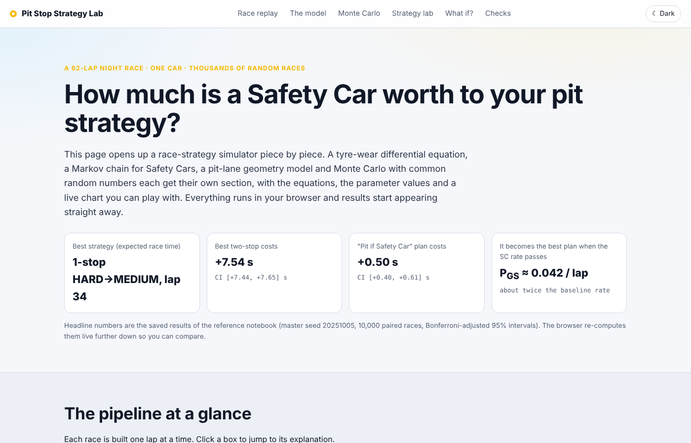
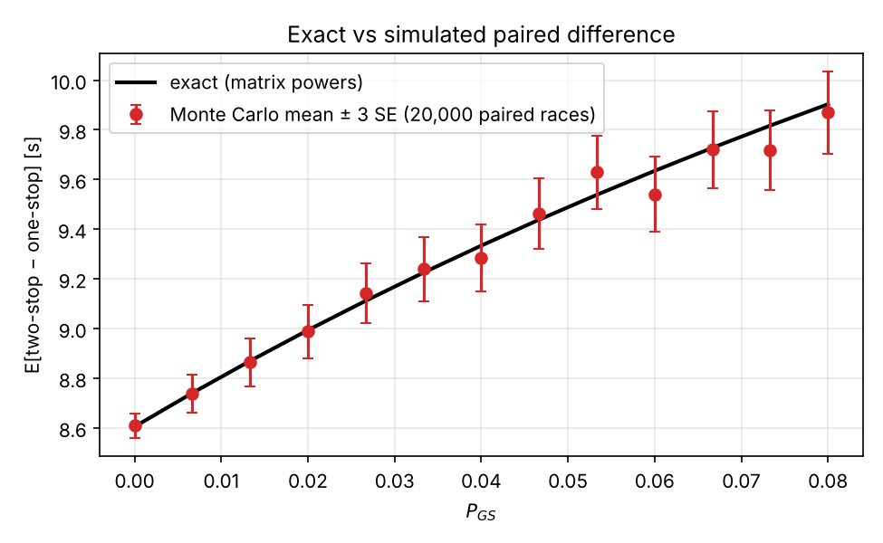
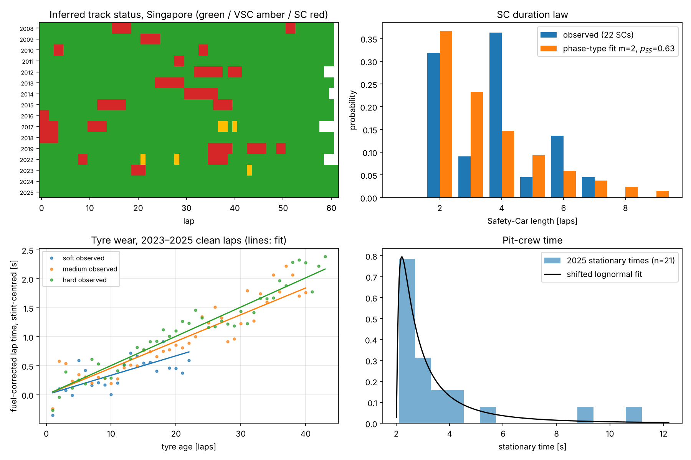
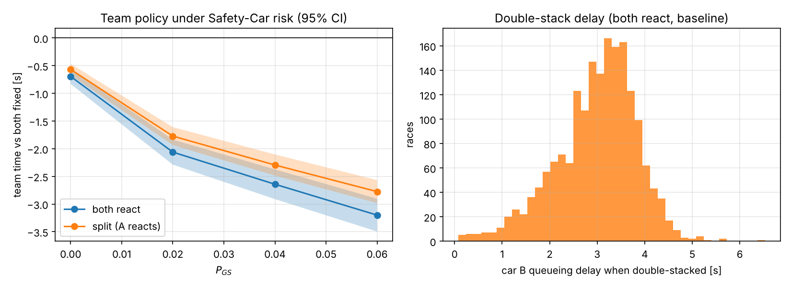

# F1 Pit-Strategy Simulator: how much is a Safety Car worth?

**A Monte Carlo race simulator, calibrated on 16 Singapore Grands Prix, that finds when a Formula 1 team should stop once, stop twice, or wait for a Safety Car.**

**▶ Live demo: <https://pitstop-strategy-lab.pages.dev/>** (Cloudflare Pages) &nbsp; [](https://colab.research.google.com/github/dinukacodes/f1-pit-strategy-simulator/blob/main/notebook/f1-pit-strategy-simulator.ipynb) &nbsp;  

[](https://pitstop-strategy-lab.pages.dev/)

## The problem in plain English

Fresh tyres are faster, but changing them costs about 20 seconds driving through the speed-limited pit lane. When a **Safety Car** (SC) or **Virtual Safety Car** (VSC) neutralises the race, everyone on track slows down but the pit lane does not, so a stop suddenly becomes cheap. Singapore is the extreme case: every race from 2008 to 2023 had at least one Safety Car, and 2024 and 2025 had none.

**Question.** For a 62-lap Singapore race, how does the expected race-time difference (with 95% confidence intervals) between the best **one-stop**, the best **two-stop** and a **pit-if-neutralised** strategy change with the per-lap Safety-Car probability $P_{GS}$, and where does the best choice switch? As an extension: when *both* team cars want the same cheap stop, is queueing in one pit box worth it?

## Quick start

**In the browser:** open the [live demo](https://pitstop-strategy-lab.pages.dev/). Nothing to install. It also works offline: double-click `docs/index.html`.

**In Colab:** click the badge above, then *Runtime → Run all*. A full run takes about a minute.

**Locally:**

```bash
git clone https://github.com/dinukacodes/f1-pit-strategy-simulator.git
cd f1-pit-strategy-simulator
python -m venv .venv && source .venv/bin/activate        # Windows: .venv\Scripts\activate
pip install -r requirements.txt
jupyter notebook notebook/f1-pit-strategy-simulator.ipynb  # Run all
```

```python
# or use the simulator directly
import sys; sys.path.insert(0, "src")
import f1sim as F
p = F.default_params()
plans = [F.strategy([34], ["HARD", "MEDIUM"]),                        # one-stop
         F.strategy([28], ["MEDIUM", "HARD"], reactive_window=(12, 28))]  # pit if neutralised
X = F.run_paired(plans, p, n_reps=10_000, seed=1)                   # common random numbers
print(F.mean_ci(X[:, 1] - X[:, 0]))                                 # paired difference, 95% CI
```

## User guide

The web demo has a lap-by-lap **race replay**, one interactive panel per model component, a **strategy lab** where you set the world and up to four strategies and get paired 95% CIs, historic **what-if** replays, and a **verification suite** that runs in your browser. See **[USER_GUIDE.md](USER_GUIDE.md)** for a walk-through with screenshots.

## Model and maths

Full derivations are in **[THEORY.md](THEORY.md)**. In short:

| Component | Equation / method |
|---|---|
| Tyre wear (ODE, **RK4**) | $\dfrac{dw}{da}=k_c\,(1+\beta m)\,(1+\eta w)\,\varphi(s)$, with an exact solution used as the RK4 reference |
| Lap time | Green: $t_\ell=t_0+\Delta_c+w_\ell+\gamma m(\ell)+\sigma\varepsilon_\ell$. Neutralised: $t_\ell=k_s t_0$ |
| Track status (**Markov chain**) | phase-type chain $\{G,V,SC_1..SC_m,SC^+\}$, minimum SC length $m$, $E[D]=m+\frac{p_{SS}}{1-p_{SS}}$ |
| Pit loss (geometry) | $(1-\alpha_s)\Delta T_G+C$, with $\alpha_s=(k_s-1)T_{bypass}/\Delta T_G$ and crew time $C=c_0+e^{\mu+\sigma Z}$ |
| Variates | Box–Muller normals; inverse transform for the lognormal and the Markov rows |
| **Monte Carlo** | common random numbers (one stream per source), two-stage screening, Bonferroni CIs |
| Team model (**discrete-event simulation**) | event list with `LINE`, `BOX_ARRIVE` and `BOX_DONE`; FIFO pit box; no passing; SC bunching |

## Verification

Every check in the notebook ends in an `assert`, so *Run all* fails loudly. The checks include: RK4 vs the closed-form solution ($<10^{-8}$ s) with measured orders 1, 2 and 4 for Euler, RK2 and RK4; a deterministic benchmark against the derived optimum $L^*$; Markov-chain stationarity, the renewal-reward law and the SC-duration law; KS tests of the samplers; Monte Carlo error falling as $N^{-1/2}$; exact reduction of the two-car model to the single-car one; and the JavaScript port against Python on the same random numbers.

The strongest single check is an **independent exact computation**: the expected paired difference between two strategies is computed from matrix powers of the Markov chain alone, and the Monte Carlo must reproduce it across the whole range of $P_{GS}$.



## Concepts applied

This project applies **numerical solution of ordinary differential equations** (classical fourth-order Runge–Kutta, compared with Euler and midpoint methods, with the global error order measured on a log–log plot against an exact solution), **input modelling and random variate generation** (Box–Muller normals, inverse-transform sampling of a shifted lognormal and of Markov-chain transitions, Kolmogorov–Smirnov goodness-of-fit tests), **discrete-time Markov chains** (a phase-type chain for Safety-Car durations, stationary distributions by renewal-reward and eigen-solve, maximum-likelihood estimation from transition counts with Beta posteriors), **Monte Carlo simulation and the law of large numbers** (common random numbers for variance reduction, confidence intervals with Bonferroni adjustment, $O(N^{-1/2})$ error, sample-size planning), and **next-event time-advance discrete-event simulation** (a two-car pit-box queue). It verifies the simulator against closed-form results: the exact ODE solution, a derived optimal pit lap, and an exact expected race-time difference from matrix powers of the chain. It grounds the model in real race data with held-out validation, and it quantifies sensitivity and parameter uncertainty.

## Results

**Baseline world** (literature and assumed values, master seed 20251005, 10,000 paired races per strategy, Bonferroni-adjusted 95% CIs):

| Strategy | vs best one-stop (HARD→MEDIUM, lap 34) |
|---|---|
| Two-stop MEDIUM→HARD→SOFT (laps 19, 46) | **+7.54 s** [+7.44, +7.65], slower |
| Pit-if-neutralised MEDIUM→HARD (plan lap 28, box at the first SC/VSC from lap 12) | **+0.50 s** [+0.40, +0.61], slower |

* More Safety Cars make the two-stop **worse**, not better. SC laps replace the Green laps on which worn tyres cost time, and tyres barely wear behind the SC. The pit-if-neutralised plan overtakes the one-stop at **$P_{GS}\approx0.042$**, about twice the baseline rate.
* CRN reduces the variance of the paired difference by about **5,000×**, because SC laps cancel exactly between strategies.

**Calibrated on real data** (16 Singapore races, 2008–2025; notebook §6.7–6.8, figure below):

* The data confirm the SC onset rate: $\hat P_{GS}=0.022$, 95% interval [0.014, 0.034]. SCs last at least 2 laps, 3.7 on average, and 3 of 16 races had a lap-1 SC.
* Two inputs change materially. SC laps run at **1.38×** Green pace, not 1.60×. The measured **pit-loss discount under an SC is 0.86**, twice the 0.43 that uniform-slowdown geometry predicts.
* With these values, **pit-if-neutralised becomes the best plan, about 4.0 s faster than the best one-stop**. It wins at every $P_{GS}$ tested, even 0, because VSCs and lap-1 SCs still happen. It stays best in **all 300** parameter draws from the data-based uncertainty.
* **Held-out validation:** wear rates fitted on 2023–24 predict 2025 stints with RMSE 1.22 s, against 1.49 s with no wear model. The SC-duration law fitted on 2008–17 passes on 2018–25 (KS p = 0.71). The 2008–17 onset rate predicts 8.1 SCs for 2018–25, and 6 were observed (p = 0.60).



**Team extension:** when both cars stop under the same neutralisation, the second car queues for about 3 s. Double-stacking is still better for the team than leaving car B out, by 0.29 s [0.20, 0.38] per race at the baseline rate. Both reactive team policies beat fixed plans by 2–3 s.



**Sensitivity and uncertainty:** the HARD wear rate and $P_{GS}$ drive the answer, while $\alpha_{SC}$ and the crew-time spread barely move it ([tornado](figures/sensitivity_tornado.png), [interaction map](figures/sensitivity_map.png), [uncertainty propagation](figures/uncertainty_propagation.png)).
**Performance:** the vectorised NumPy simulator is about **30×** faster than a per-race loop and gives identical results (≈300,000 races/s; [scaling plot](figures/performance_scaling.png)).

### Limitations

Single objective (expected race time, not position); no full-field traffic (the team model covers team-mates only); track status inferred from lap times, since the public data has no status flag; compound pace offsets, the fuel effect and the SOFT wear rate are still assumed; the 2025 pit-lane speed applies throughout; no weather or red flags.

### Future work

An optimal reactive policy by dynamic programming over (lap, status, tyre age, stops left); a full-field traffic model built on the discrete-event engine; per-team crew-time distributions; an in-browser Pyodide build of the Python model.

## Extensions in this repository

| Extension | Where |
|---|---|
| Rigorous verification: second independent check plus measured error scaling | notebook §5.1, §5.7, §5.8 · [THEORY.md §4](THEORY.md#4-verification) · `figures/convergence_ode.png`, `convergence_mc.png`, `verification_exact_vs_mc.png` |
| Stretch model: two-car team DES with pit-box queueing, verified by exact reduction | `src/f1sim.py` (*Two-car team model*) · notebook §5.9, §6.6 · `figures/team_double_stack.png` |
| Real-data grounding: calibration and held-out validation | `src/calibrate.py`, `data/` · notebook §6.7 · `figures/calibration_real_data.png` |
| Sensitivity and uncertainty analysis | notebook §6.4, §6.8 · `figures/sensitivity_*.png`, `uncertainty_propagation.png` |
| Performance engineering | notebook §6.5 · `figures/performance_scaling.png` |

## Repository layout

```
├── README.md            ├── THEORY.md        ├── USER_GUIDE.md     ├── REFERENCES.md     ├── LICENSE
├── notebook/            f1-pit-strategy-simulator.ipynb (generated from src/ by tools/build_notebook.py)
├── src/                 f1sim.py (model, solvers, Markov chain, Monte Carlo, team DES) · calibrate.py
├── data/                Singapore race data (CC BY-NC-SA 4.0) + README
├── figures/             verification and result plots, demo screenshots
├── docs/                Cloudflare Pages build of the web demo
├── web/                 demo source (HTML, JS port of the model, build and port-verification tools)
├── tools/               notebook builder, data downloaders
└── requirements.txt
```

## Key references

1. A. Heilmeier, M. Graf, J. Betz, M. Lienkamp, "Application of Monte Carlo methods to consider probabilistic effects in a race simulation for circuit motorsport," *Appl. Sci.* 10(12):4229, 2020. [doi:10.3390/app10124229](https://doi.org/10.3390/app10124229)
2. A. Heilmeier, A. Thomaser, M. Graf, J. Betz, "Virtual Strategy Engineer," *Appl. Sci.* 10(21):7805, 2020. [doi:10.3390/app10217805](https://doi.org/10.3390/app10217805)
3. A. M. Law, *Simulation Modeling and Analysis*, 5th ed., McGraw-Hill, 2015.
4. P. Glasserman, *Monte Carlo Methods in Financial Engineering*, Springer, 2003.
5. Jolpica-F1 and OpenF1 open data APIs (CC BY-NC-SA 4.0).

The full list, with DOIs, is in [REFERENCES.md](REFERENCES.md).

## AI assistance

This project was built with substantial help from AI coding assistants (Anthropic's Claude) for code, verification design and documentation. All results come from the code in this repository and can be reproduced with *Run all*.

## Licence and data

* **Code:** [MIT](LICENSE).
* **Data** in `data/`: derived from [Jolpica-F1](https://github.com/jolpica/jolpica-f1) and [OpenF1](https://openf1.org), licensed **CC BY-NC-SA 4.0** (non-commercial, share-alike). See [data/README.md](data/README.md).
* KaTeX (MIT) is bundled in `docs/vendor/` for offline maths rendering.
* This is an independent project, not affiliated with Formula 1, the FIA or any team.
