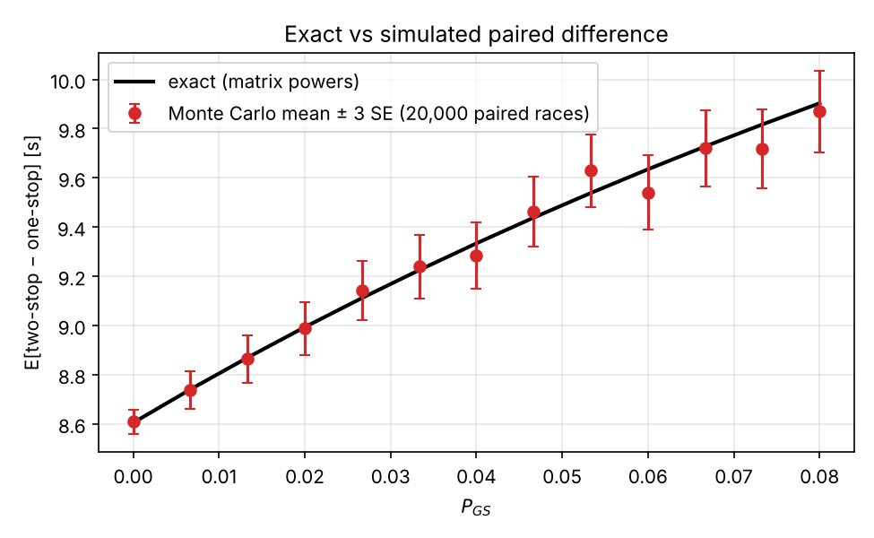
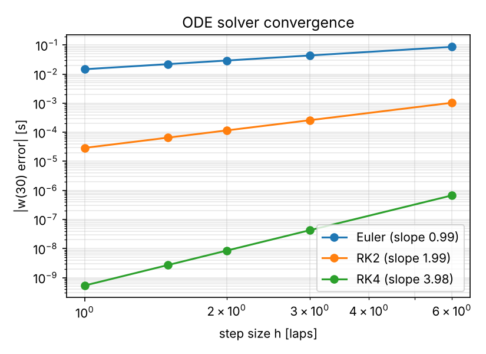
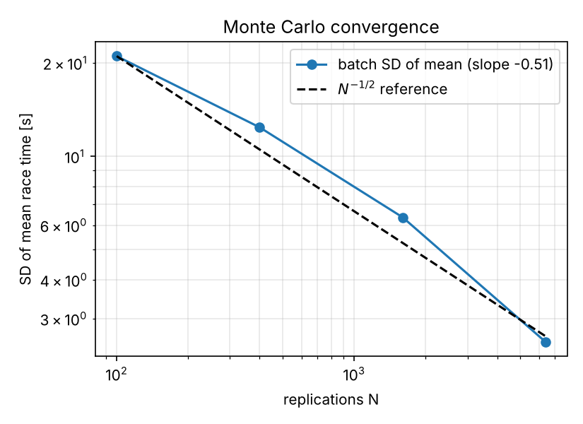

# Theory: model, numerical schemes and verification

This document collects the mathematics behind the simulator: the model equations, the assumptions they rest on, the numerical and statistical methods, the results derived from them, and the checks that confirm the code matches the mathematics. Section numbers in brackets (§5.4) refer to the notebook.

Notation: $N$ laps; race lap $\ell=1,\dots,N$; compound $c\in\{S,M,H\}$ with pace offset $\Delta_c$ and wear rate $k_c$; track status $s\in\{G,V,S\}$ (Green, Virtual Safety Car, Safety Car). Times are in seconds, fuel in kilograms.

---

## 1. Assumptions

| # | Assumption | Why it is reasonable | What it makes possible |
|---|---|---|---|
| H1 | Lap-discrete time, fixed race distance, no red flags | status, stops and tyre life are logged per lap | a finite-horizon Markov chain |
| H2 | Track status is exogenous (independent of our strategy) | one car barely changes incident risk | a valid common-random-numbers design |
| H3 | Markov and time-homogeneous after lap 1, with a separate lap-1 onset probability | lap-1 incidents are over-represented | exact lap marginals $p(\ell)=p(1)P^{\ell-1}$ |
| H4 | An SC lasts at least $m$ laps (phase-type), then ends with probability $1-p_{SS}$ per lap | real SCs last about 2–8 laps; a plain chain makes 1 lap the most likely length | a closed-form duration law and its MLE |
| H5 | VSC and SC periods end in Green | escalations are rare | renewal-reward stationary fractions |
| H6 | Under VSC/SC the lap time is $k_s t_0$, set by the neutralisation | cars follow the SC or the VSC delta | SC laps cancel in paired differences |
| H7 | Green lap time is additive and separable | standard in race simulation [1, 2] | linearity of expectation |
| H8 | Tyre wear is smooth and self-accelerating, with no cliff inside a stint | worn tyres overheat | a closed form, a convex stint cost, a meaningful RK4 order |
| H9 | Pit lane at constant limiter speed; the bypassed track section slows by $k_s$ | pit limiter | a derived $\alpha_s$ instead of an assumed one |
| H10 | i.i.d. Gaussian lap noise; i.i.d. shifted-lognormal crew time | standard input models | CLT, exact sampler tests |
| H11 | Risk-neutral objective (expected race time) | single car, no positions | a well-posed comparison |
| H12 | Race time is non-decreasing in every common random input | true by construction | CRN cannot increase variance |
| H13 | Stage 2 uses fresh seeds, and the shortlist is fixed beforehand | avoids winner's-curse bias | unbiased final estimates |

## 2. Model

### 2.1 Fuel and tyre wear (ODE)

Fuel mass: $m(\ell)=m_0-b(\ell-1)$. Tyre degradation $w$ [s] as a function of tyre age $a$ [laps] in a stint starting on lap $s_0$:

$$\frac{dw}{da}=k_c\,\big(1+\beta\,m(s_0+a)\big)\,(1+\eta\,w)\,\varphi(s),\qquad w(0)=0,$$

with $\varphi(G)=1$, $\varphi(V)=\varphi_V=0.5$, $\varphi(S)=\varphi_S=0.25$ [2]. The term $\beta$ makes a heavy car wear its tyres faster, and $\eta>0$ makes worn tyres degrade faster.

**R1 (exact solution, constant $\varphi$).** The equation separates:

$$w(a)=\frac{e^{\eta k_c\varphi A(a)}-1}{\eta},\qquad A(a)=\big(1+\beta(m_0-b(s_0-1))\big)a-\tfrac{\beta b}{2}a^2 .$$

As $\eta\to 0$ this tends to $w=k_c\varphi A(a)$. This is the reference for the RK4 checks.

### 2.2 Lap time

$$t_\ell=\begin{cases}t_0+\Delta_c+w_\ell+\gamma\,m(\ell)+\sigma\varepsilon_\ell, & s_\ell=G,\quad \varepsilon_\ell\sim N(0,1)\\[2pt] k_s\,t_0, & s_\ell\in\{V,S\}\end{cases}$$

**R4.** $\gamma m(\ell)$ depends only on the lap, so it cancels in every strategy difference. Fuel affects strategy only through the wear coupling $\beta$.
**R5.** Under H2 and H6, neutralised laps cost every strategy the same, so they cancel in paired differences. The SC changes strategy only through cheaper stops and slower wear.

### 2.3 Track status: a phase-type Markov chain

Expanded states $\{G,V,SC_1,\dots,SC_m,SC^+\}$, with $SC_i\to SC_{i+1}$ with probability 1 and $SC_m,SC^+\to SC^+$ with probability $p_{SS}$ (otherwise $\to G$). The rows for $G$ and $V$ are $(1-a-c,\ a,\ c)$ and $(1-p_{VV},\ p_{VV})$ with $a=P_{GV}$ and $c=P_{GS}$. Lap 1 has its own SC onset probability $p_1$.

**R8 (duration law).** $D_S=m+\text{Geom}(1-p_{SS})$ on $\{0,1,\dots\}$, so

$$E[D_S]=m+\frac{p_{SS}}{1-p_{SS}},\qquad \hat m=\min_i D_i,\qquad \hat p_{SS}=\frac{\sum_i (D_i-\hat m)}{\sum_i (D_i-\hat m+1)} .$$

**R9 (stationary fractions by renewal-reward, H5).**

$$\pi_G=\frac{1}{1+aE[D_V]+cE[D_S]},\qquad \pi_V=aE[D_V]\pi_G,\qquad \pi_S=cE[D_S]\pi_G .$$

**Exact marginals.** $p(\ell)=p(1)P^{\ell-1}$, collapsed to $(G,V,S)$.

**Maximum likelihood from data [8].** With $n_{ij}$ observed transitions, $\hat P_{ij}=n_{ij}/\sum_k n_{ik}$. With few races, uncertainty on an onset probability is expressed by a Beta posterior $\text{Beta}(1+n_{GS},\,1+n_G-n_{GS})$.

### 2.4 Pit loss from pit-lane geometry

Green net transit loss: $\Delta T_G=T_{pit}-T_{bypass}$. Under neutralisation $s$ the bypassed section takes $k_sT_{bypass}$, while the speed-limited lane does not change:

$$\Delta T_s=T_{pit}-k_sT_{bypass}=(1-\alpha_s)\Delta T_G,\qquad \alpha_s=\frac{(k_s-1)\,T_{bypass}}{\Delta T_G}.$$

**R10.** A neutralised stop is cheaper if and only if $k_s>1$. This is why the pit loss under a full-course yellow "cannot simply be halved" [1]: it depends on the track geometry.

The stationary (crew) time is added unscaled: $C=c_0+e^{\mu+\sigma Z}$, a shifted lognormal.

### 2.5 Strategies

A strategy is a list of in-laps and one dry compound per stint, with at least two different compounds (as the sporting regulations require). The **pit-if-neutralised** variant moves the first stop to the first VSC/SC lap inside a window $[a,b]$.

## 3. Numerical schemes

### 3.1 ODE solvers

Classical RK4 with one step per lap ($h=1$), since the status and hence $\varphi$ are constant within a lap:

$$y_{n+1}=y_n+\tfrac h6(k_1+2k_2+2k_3+k_4),\quad k_1=f(t_n,y_n),\ k_2=f(t_n+\tfrac h2,y_n+\tfrac h2k_1),\ k_3=f(t_n+\tfrac h2,y_n+\tfrac h2k_2),\ k_4=f(t_n+h,y_n+hk_3).$$

The local error is $O(h^5)$ and the global error $O(h^4)$ [12]. Forward Euler ($O(h)$) and midpoint RK2 ($O(h^2)$) are implemented for comparison. The growth rate is $\lambda=\eta k_c(1+\beta m)\approx10^{-3}$ per lap, so $|h\lambda|\ll1$ and the scheme is far inside its stability region.

**R13 (a trap avoided).** With $\eta=0$ the right-hand side does not depend on $w$, so RK4 reduces to Simpson's rule and is exact for this quadratic integrand. A convergence plot would then show only round-off noise. The order study therefore uses $\eta>0$.

### 3.2 Random variate generation

* **Normals: Box–Muller [7].** $Z_1=\sqrt{-2\ln U_1}\cos2\pi U_2$ and $Z_2=\sqrt{-2\ln U_1}\sin 2\pi U_2$ give independent $N(0,1)$ pairs.
* **Crew time: inverse transform.** $F^{-1}(u)=c_0+\exp(\mu+\sigma\Phi^{-1}(u))$. This is exact, so the sampler can be tested against the closed-form CDF.
* **Markov chain: inverse transform on each row.** The next state is the first $j$ with $U\le\sum_{k\le j}P_{ik}$.

### 3.3 Monte Carlo with common random numbers

Three independent streams (status, lap noise, crew time) are spawned from one `SeedSequence`. Every strategy reads the same numbers, even when strategies have different numbers of stops.

$$\operatorname{Var}(T_B-T_A)=\operatorname{Var}T_A+\operatorname{Var}T_B-2\operatorname{Cov}(T_A,T_B).$$

**R11.** If both race times are non-decreasing functions of the same independent inputs (H12), their covariance is non-negative by the association inequality [6], so CRN never hurts. Together with R5, SC laps cancel exactly and the measured variance reduction is in the thousands.

**Confidence intervals.** $\bar D\pm z\,s_D/\sqrt n$, with $z=z_{1-0.05/(2k)}$ for $k$ simultaneous comparisons (Bonferroni).
**R12 (sample size).** A half-width $h^*$ needs $n\ge (z\,\hat s_D/h^*)^2$, with $\hat s_D$ taken from stage 1.
**Two-stage design (H13).** Stage 1 screens all legal strategies on 1,000 common scenarios. Stage 2 re-runs the fixed shortlist on 10,000 fresh scenarios.

### 3.4 Two-car team model: next-event discrete-event simulation

Two team-mates share one pit box. The simulation keeps an event list (a binary heap ordered by time) with three event types:

| Event | Effect |
|---|---|
| `LINE(car)` | The car crosses the line. If it starts the lap behind its team-mate (and neither is in the pit lane), it cannot cross less than `follow_gap` behind it (no passing). On SC laps the trailing car closes up to `sc_gap` (bunching). Otherwise the next lap starts. |
| `BOX_ARRIVE(car)` | The car arrives at the box halfway through its pit-lane transit. If the box is busy or a car is queued, the car joins a FIFO queue. If the crew is still resetting (turnaround $\tau$), it waits until the box is free. |
| `BOX_DONE(car)` | Service ends after the crew time $C$. The car leaves for the second half of the transit, and the next queued car starts service at $\max(t+\tau,\,t_{arrive})$. |

The clock jumps from event to event (next-event time advance [5]). Car A uses exactly the single-car random streams. Car B has its own crew stream and lap noise correlated with A's ($\rho=0.7$, shared track evolution), and both share the track status.

**Reduction property.** With interaction off, or with stops that never overlap and no traffic, each car's total equals the single-car simulator's total exactly. In a deterministic race where both cars stop on the same lap, car B waits exactly $C+\tau-g_0$, where $g_0$ is the grid gap.

### 3.5 Real-data calibration

Data: 16 Singapore races (2008–2025) from Jolpica-F1, and 2023–2025 stints, compounds and race-control messages from OpenF1 (see [data/README.md](data/README.md)).

* **Track status from lap times.** The public lap data has no status flag, so each race lap is classified from the field's median lap time $\tilde t_\ell$ relative to the race's Green pace $\tilde t_G$. A lap is *neutralised* when $\tilde t_\ell/\tilde t_G>\theta$. A neutralised run is a **Safety Car** if the field closes up (the median gap between consecutive cars shrinks by more than half), and a **VSC** if the gaps are preserved (VSC exists only from 2015). The classifier is validated against OpenF1's race-control messages.
* **Transition matrix.** Maximum likelihood from the transition counts, a Beta posterior for $P_{GS}$, and the phase-type fit of the SC durations (R8).
* **Neutralised pace.** $k_S$ and $k_V$ are the median ratios of fully neutralised laps to the Green pace.
* **Pit loss.** Net loss = in-lap + out-lap − 2 × the driver's median clean lap, for Green stops. With the pit-lane time $T_{lane}$ (entry to exit, including the stop) and the stationary time $C$: $T_{pit}=T_{lane}-C$ and $T_{bypass}=T_{lane}-\text{net loss}$. Only 2025 is used for the 80 km/h pit lane.
* **Tyre wear.** A regression with stint fixed effects on clean Green laps, $t=\alpha_{\text{stint}}+k_c\,\text{age}+\epsilon$, gives the per-compound wear rates.
* **Held-out validation.** Wear rates fitted on earlier races are tested on 2025 stints (lap-time RMSE). SC durations fitted on 2008–2017 are tested on 2018–2025 (KS test).

The fitted values and validation metrics are printed in notebook §6.7 and summarised in the README.

## 4. Verification

| Check | Expected | Tolerance | Notebook |
|---|---|---|---|
| RK4 vs closed form R1 | match | $10^{-8}$ s | §5.1 |
| Measured orders Euler / RK2 / RK4 | 1 / 2 / 4 (log–log slope) | ±0.3 | §5.1 |
| Deterministic benchmark vs hand-derived totals | equal | $10^{-6}$ s | §5.2 |
| Simulated best one-stop lap vs $L^*$ (R2) | $\lfloor L^*\rfloor$ or $\lceil L^*\rceil$ | exact | §5.2 |
| Markov matrices valid across the whole $P_{GS}$ sweep | rows sum to 1, entries ≥ 0 | $10^{-12}$ | §5.3 |
| Empirical status frequencies vs R9 and the eigen-solve | equal | 0.01 | §5.3 |
| SC length ≥ m, mean = $E[D_S]$, MLE recovers $m,p_{SS}$ | — | 3 SE / 0.03 | §5.3 |
| MC mean vs exact expectation (R6) | equal | 3 SE | §5.4 |
| Conservation: 62 laps, fuel ≥ 0, age resets, identical strategies differ by 0, loop = vectorised | — | $10^{-9}$ s | §5.5 |
| Box–Muller and crew-time samplers (KS) | $D_n<1.36/\sqrt n$ | 5% | §5.6 |
| MC error vs $N$ | slope −0.5 | ±0.15 | §5.7 |
| **Exact paired-difference curve vs MC across 13 values of $P_{GS}$** | inside ±3 SE | all points | §5.8 |
| **Two-car model reduces to the single-car model; queue delay $=C+\tau-g_0$** | exact | $10^{-9}$ s | §5.9 |
| JavaScript port vs Python on the same random numbers | identical | $10^{-8}$ s | web demo *Checks* |

**R2 (deterministic optimum).** With linear wear ($\eta=\beta=0$, $\varphi=1$), the one-stop cost $f(L)=\Delta_1L+k_1\frac{L(L-1)}2+\Delta_2(N-L)+k_2\frac{(N-L)(N-L-1)}2$ is convex, since $f''=k_1+k_2>0$, and

$$L^*=\frac{k_2N+(\Delta_2-\Delta_1)+(k_1-k_2)/2}{k_1+k_2}.$$

**R3 (one vs two stops, Green, equal stints).** A second stop saves $kN^2/12$ in degradation, so the two-stop wins if and only if $kN^2/12>\Delta T_G+E[C]$.

**R6 (exact expected race time and paired difference).** With linear wear and $\varphi=1$,

$$E[T]=\sum_\ell\Big(p_G(\ell)\,g_\ell+p_V(\ell)k_Vt_0+p_S(\ell)k_St_0\Big)+\sum_{L\in\mathcal L}\Big(E[C]+\Delta T_G\big(1-\alpha_Vp_V(L)-\alpha_Sp_S(L)\big)\Big),$$

computed with matrix powers only. The Monte Carlo must reproduce it (§5.4), and the paired difference $E[T_B-T_A]$ is checked across the whole $P_{GS}$ range (§5.8, figure below).

 

## 5. Sensitivity and uncertainty

* **One-at-a-time sweeps** (tornado, §6.4) of $P_{GS}$, $\alpha_{SC}$, the minimum SC length, the crew-time spread and the HARD wear rate, each point with a 95% CI.
* **Interaction map** (§6.4) of *pit-if-neutralised − one-stop* over a grid of $P_{GS}$ and the HARD wear rate, with every cell marked by the sign of its CI.
* **Parameter-uncertainty propagation** (§6.7): $P_{GS}$ is drawn from its data-based Beta posterior and the wear rates from their bootstrap distribution, and each draw is pushed through a paired simulation. This gives the probability that each plan is best, accounting for parameter uncertainty as well as race randomness.

## 6. Performance

The plain-Python simulator advances one race at a time. The vectorised simulator advances **all** races one lap at a time: each RK4 stage, lap-time formula and pit decision becomes one NumPy operation over arrays of length $N$. The Python interpreter overhead is then paid $62$ times per strategy instead of $62N$ times. Results are identical to $10^{-9}$ s, and the measured speed-up is about 30× at $N=2{,}000$ (§6.5, figure `performance_scaling.png`). The web demo runs the same algorithm in JavaScript inside a Web Worker, so the page stays responsive while 10,000 races stream in.

References are numbered as in [REFERENCES.md](REFERENCES.md).
