# User guide

This guide covers the **web demo** (the *Pit Stop Strategy Lab*) and the **notebook**. The web demo runs entirely in your browser. Nothing is installed and nothing is sent to a server.

**Live demo:** <https://pitstop-strategy-lab.pages.dev/> (GitHub Pages copy: <https://dinukacodes.github.io/f1-pit-strategy-simulator/>)
**Offline:** download the repository and double-click `docs/index.html`. It works from `file://` too.

---

## 1. The page at a glance

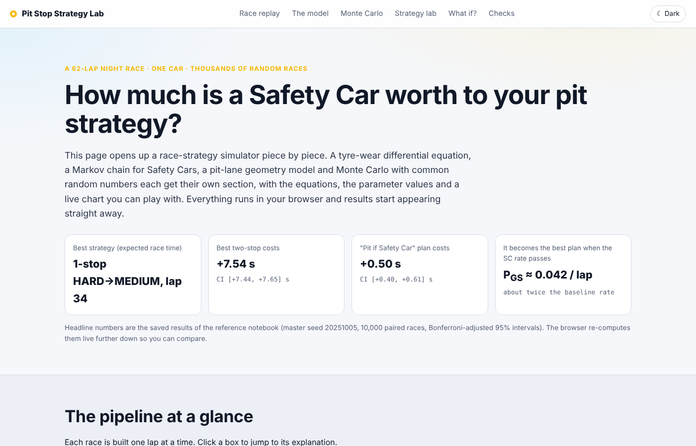

The header cards show the study's headline numbers. They come from the reference notebook run (master seed `20251005`, 10,000 paired races, Bonferroni-adjusted 95% intervals). Everything below them can be re-computed live in your browser.

The top bar jumps to each section: **Race replay → The model → Monte Carlo → Strategy lab → What if? → Checks**. The **☾ Dark** button switches the colour theme, and your choice is remembered.

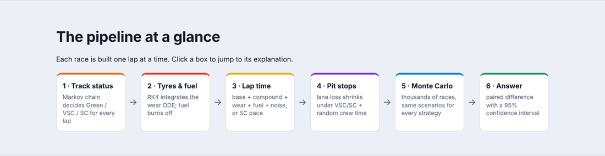

*The pipeline at a glance* shows the six steps that turn random inputs into an answer. Click a box to jump to its explanation.

## 2. One race, lap by lap

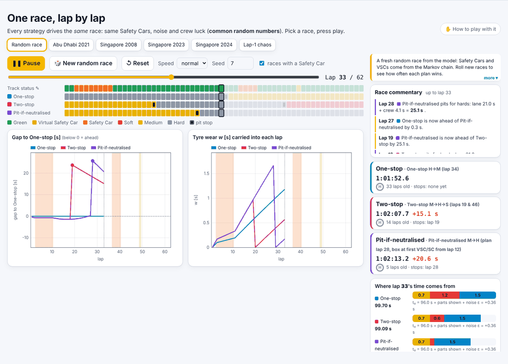

1. **Pick a race.** *Random race* draws Safety Cars from the Markov chain. The other buttons replay real track-status sequences (Singapore 2008, 2023, 2024, Abu Dhabi 2021) and a lap-1 chaos case.
2. Press **▶ Start** (it becomes **❚❚ Pause** while the race runs). The three strategies (one-stop, two-stop, pit-if-neutralised) race through the *same* scenario: the same Safety Cars, the same lap noise and the same crew luck. This is the *common random numbers* idea.
3. **🎲 New random race** draws a new scenario (change **Seed** to get a specific one). **↺ Reset** rewinds. **Speed** sets the playback rate, and the slider scrubs to any lap.
4. Read the charts: *Gap to One-stop* (below 0 = ahead), *Tyre wear w* (resets to 0 at each stop), the strip of Green / VSC / SC laps, and the race commentary. The breakdown at the bottom right splits the current lap time into base, compound, wear, fuel and noise.

## 3. The model, one component at a time

| Panel | What you can do |
|---|---|
| 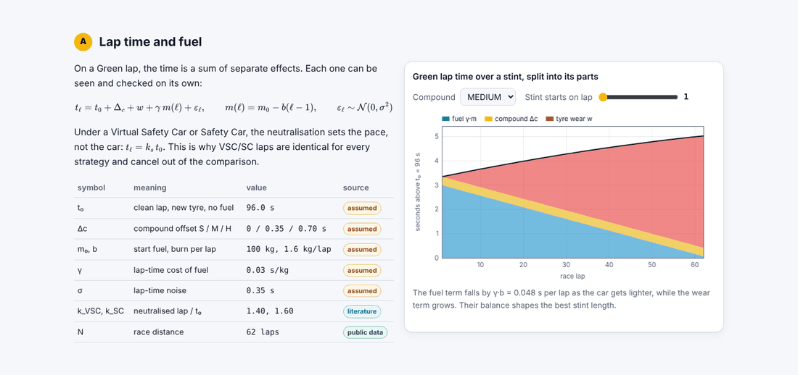 **A Lap time and fuel** | Change the compound and the stint start lap. The stacked area shows how fuel, compound offset and tyre wear add up. |
| 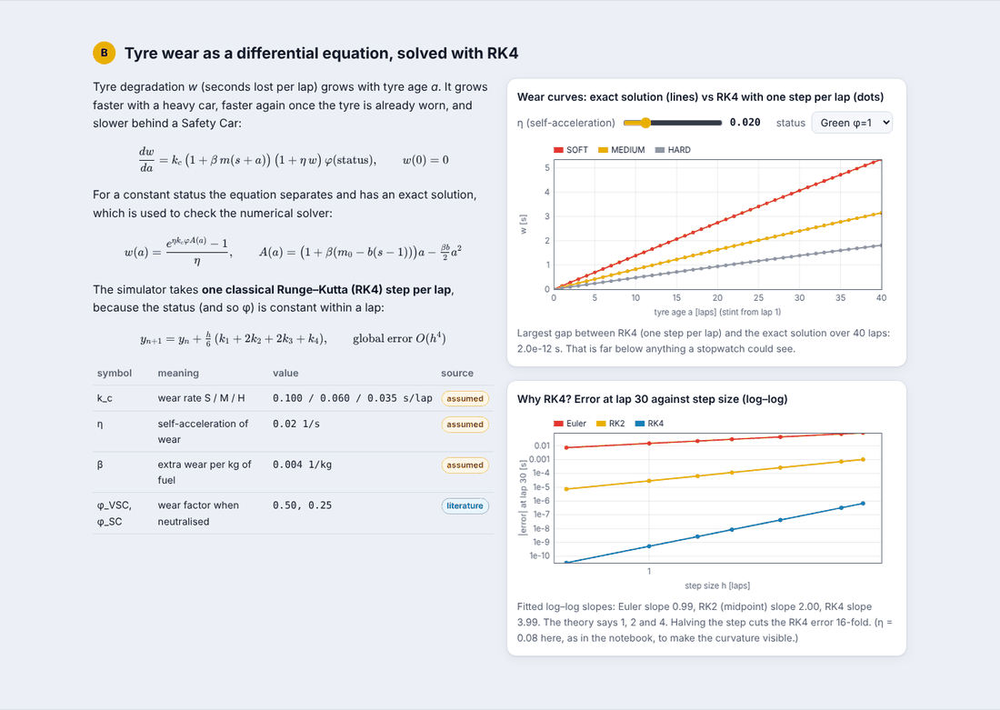 **B Tyre wear (RK4)** | Change the step size. Euler, RK2 and RK4 are compared with the exact solution, and the error chart shows their orders (1, 2, 4). |
| 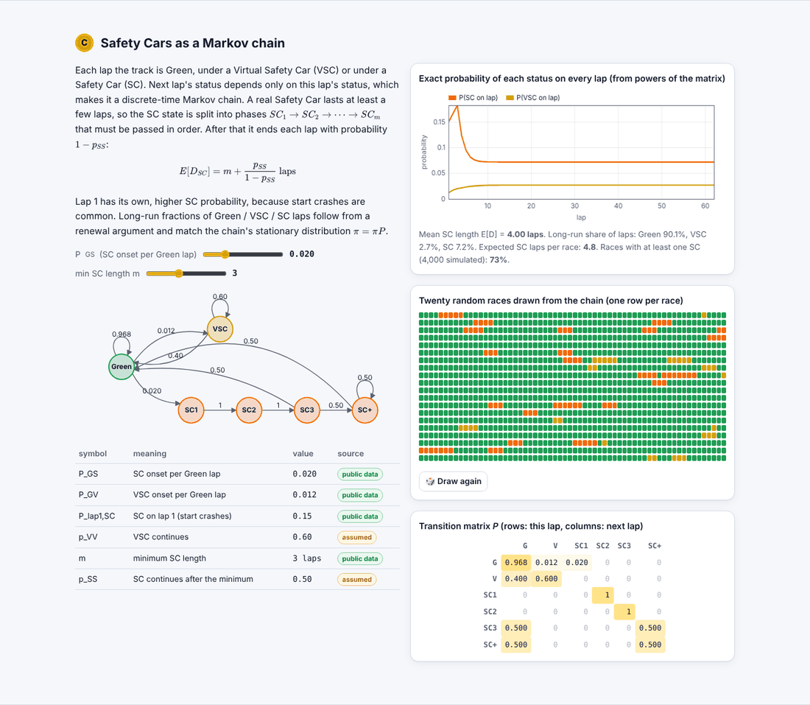 **C Safety Cars as a Markov chain** | Move $P_{GS}$, the minimum SC length and the persistence. **🎲 Draw again** samples new seasons, and the histogram of SC lengths is compared with the phase-type formula. |
| 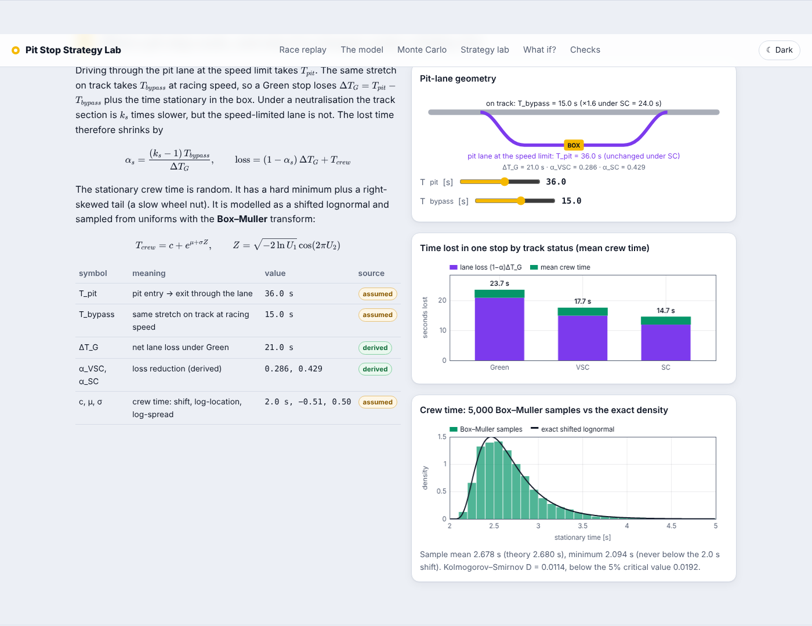 **D Pit-stop cost** | Change the pit-lane time and the bypassed-section time. The derived $\alpha_{VSC}$ and $\alpha_{SC}$ update, together with the cost of a stop under each status. |
| 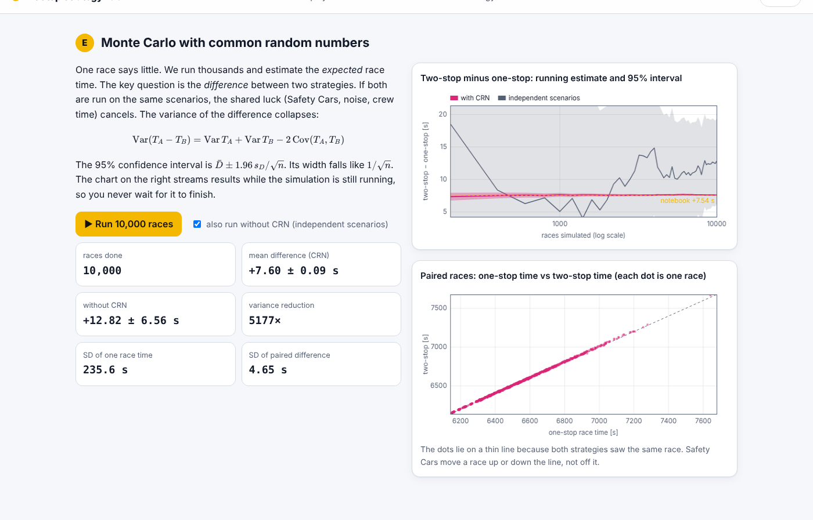 **E Monte Carlo with CRN** | **▶ Run 10,000 races** streams batches from a Web Worker. Watch the 95% CI narrow as $N^{-1/2}$, and compare paired (CRN) with independent sampling. |

Every parameter carries a badge: <kbd>literature</kbd>, <kbd>public data</kbd> or <kbd>assumed</kbd>.

## 4. Strategy lab

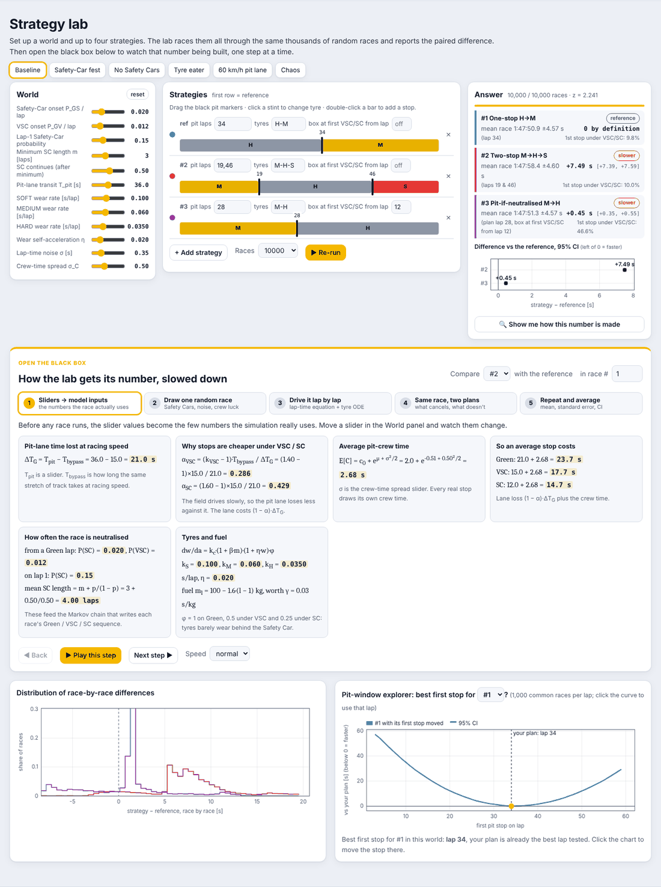

1. **Choose a world** with a preset (*Baseline*, *Safety-Car fest*, *No Safety Cars*, *Tyre eater*, *60 km/h pit lane*, *Chaos*), or set the sliders yourself in the **World** panel.
2. **Edit the strategies.** Type the pit laps (for example `19,46`) and tyres (for example `M-H-S`), drag the black pit markers, click a stint to change its tyre, or double-click a bar to add a stop. Set *box at first VSC/SC from lap …* to turn a plan into a pit-if-neutralised plan. The first row is the reference. Up to four strategies are allowed, and illegal ones (a single compound, laps out of range) are flagged.
3. Choose the number of **Races** and press **▶ Re-run**. The *Answer* card gives each strategy's mean race time ± CI and its paired difference to the reference, with a Bonferroni-adjusted $z$.
4. **🔍 Show me how this number is made** opens a step-by-step walk-through: sliders → model inputs → one random race → lap-by-lap equations → paired differences → mean and CI.
5. The **pit-window explorer** sweeps the first stop of any strategy across the race. Click the curve to move the stop there.

## 5. The study's answer, what-ifs and checks

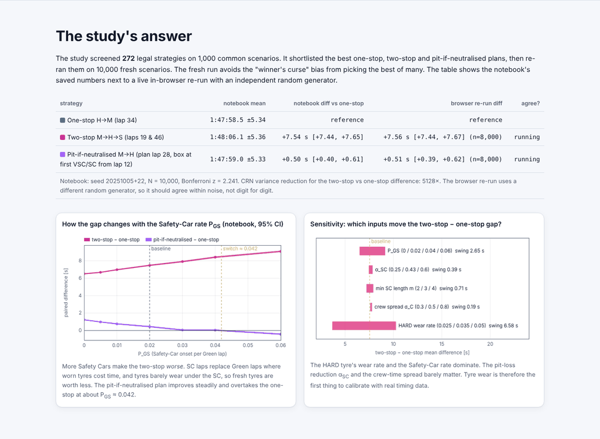

*The study's answer* puts the notebook's saved results next to a live browser re-run made with an independent random generator. They should agree within noise, not digit for digit.

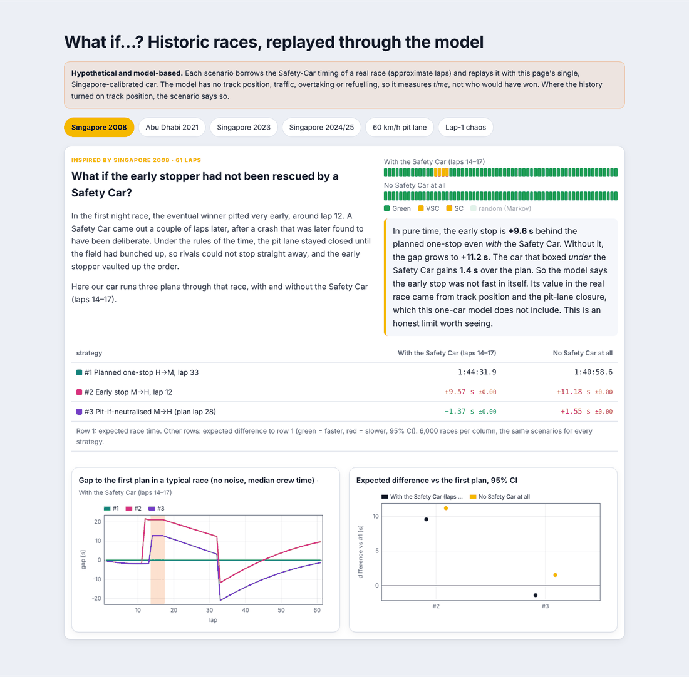

*What if…?* replays historic races (real Safety-Car laps) through the model and shows which plan would have won.

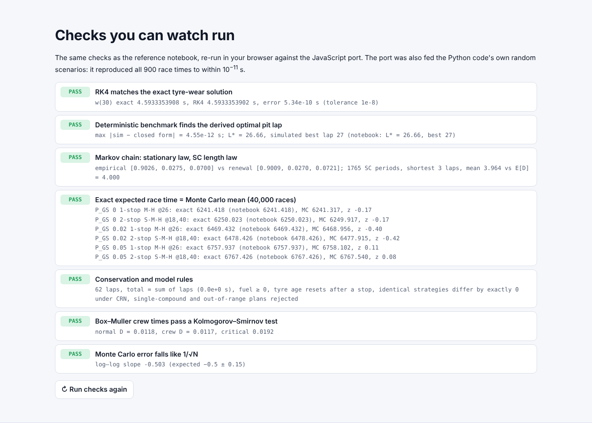

*Checks you can watch run* executes the verification suite in your browser. It covers the RK4 error order, Markov-chain stationarity, the SC duration law, the deterministic optimum $L^*$, the exact expectation vs Monte Carlo, conservation laws, and the JavaScript port against the Python model on the same random numbers. **↻ Run checks again** re-runs them.

## 6. Notebook

[](https://colab.research.google.com/github/dinukacodes/f1-pit-strategy-simulator/blob/main/notebook/f1-pit-strategy-simulator.ipynb)

* **Colab:** click the badge, then *Runtime → Run all*. The notebook downloads the small CSV files in `data/` from this repository when they are not available locally, and the full run takes about a minute.
* **Locally:**
  ```bash
  git clone https://github.com/dinukacodes/f1-pit-strategy-simulator.git
  cd f1-pit-strategy-simulator
  python -m venv .venv && source .venv/bin/activate      # Windows: .venv\Scripts\activate
  pip install -r requirements.txt
  jupyter notebook notebook/f1-pit-strategy-simulator.ipynb
  ```
* Every check in §5 ends in an `assert`, so a failure stops *Run all*. Every experiment prints its seed.
* To change the model, edit `src/f1sim.py` (or `src/calibrate.py`) and rebuild the notebook with `python tools/build_notebook.py`. The notebook is generated from the source, so the two never drift apart.

## 7. Rebuilding the web demo

```bash
cd web
npm i katex@0.16.11 esbuild@0.24.0
python tools/export_notebook_results.py        # refresh the saved notebook numbers + Python fixture
node tools/verify_port.js tools/python_fixture.json   # JS port must match Python on the same random numbers
node tools/build.js                            # writes ../docs (GitHub Pages)
```

## 8. Refreshing the real data

```bash
python tools/fetch_race_data.py     # Jolpica-F1: Singapore 2008–2025 laps, pit stops, results
python tools/fetch_openf1_data.py   # OpenF1: 2023–2025 stints, compounds, pit stops, race control
```

Both downloaders respect the APIs' rate limits, so a full refresh takes a few minutes. See [data/README.md](data/README.md) for sources and licences.
